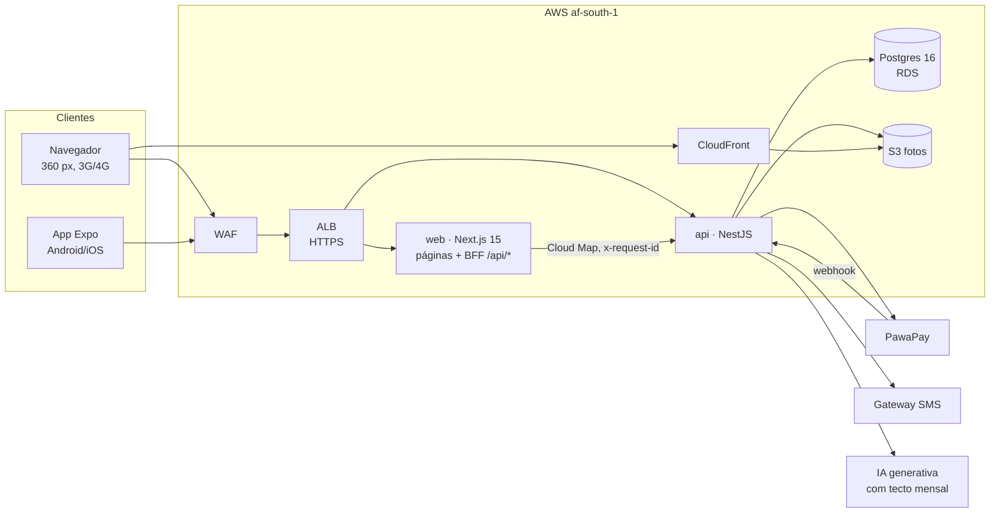

# Arquitectura da Nhonga (estado em 22/11/2026)

Classificados de Moçambique: quem vende publica, quem compra contacta (WhatsApp,
telefone ou mensagem na plataforma) e o negócio fecha-se entre as partes. A
Nhonga cobra serviços ao vendedor (destaques, subir ao topo, Pro, banners) com
uma carteira pré-paga carregada por M-Pesa/e-Mola (PawaPay).

## Visão geral

| Peça               | Tecnologia                        | Onde                         |
| ------------------ | --------------------------------- | ---------------------------- |
| Site + BFF         | Next.js 15 (App Router), React 19 | `apps/web`                   |
| API                | NestJS 11, Drizzle, Postgres 16   | `apps/api`                   |
| App                | Expo 57 (React Native)            | `apps/mobile` (npm, à parte) |
| Regras partilhadas | TypeScript (dinheiro, telefone)   | `packages/shared`            |
| Infra              | Terraform (ECS Fargate, RDS…)     | `infra/terraform`            |
| Testes E2E         | Playwright + axe, 360 px          | `apps/e2e`                   |

## Princípios que o código segue

- **O navegador nunca fala com a API.** O site chama o seu BFF (`/api/*`), que
  lê o cookie de sessão `httpOnly` e chama a API pela rede privada. A API
  só é pública para a app.
- **Dinheiro em centavos inteiros**, um crédito por pagamento (idempotente),
  webhooks nunca são a fonte da verdade (a API confirma no gateway).
- **Telefone como identidade.** Login por código SMS (6 dígitos, hash Argon2,
  5 tentativas, uso único atómico, limites por número e global).
- **Contas verificadas para escrever.** Publicar, mensagens, alertas,
  avaliações e publicidade exigem sessão; os limites contra abuso são
  contados em Postgres e valem para todas as instâncias.
- **Nada de segredos em ficheiros.** Segredos no Secrets Manager, deploy por
  OIDC sem chaves, imagem imutável por SHA.

## Módulos da API

`auth` (OTP, sessões, conta: eliminar e exportar) · `catalog` (anúncios,
pesquisa, denúncias, expiração) · `media` (fotos → S3) · `messaging`
(conversas, bloqueios) · `wallet` + `checkout` + `payments` (carteira,
pacotes, gateways com failover) · `promotions`, `subscriptions`, `ads`,
`banners` (serviços pagos) · `alerts` (pesquisas guardadas) · `favorites`,
`reviews`, `notifications` (SMS, push, in-app) · `assistant` (IA).

Contrato completo, gerado do código e verificado nos testes:
[`apps/api/openapi.yaml`](../apps/api/openapi.yaml) (`/v1`, corpos validados
por Zod, `Idempotency-Key` nos pagamentos, paginação por cursor). Resumo das
rotas: [`docs/api/rotas.md`](api/rotas.md).

## Dados

- Postgres é a única fonte de verdade. Migrações: as do Drizzle (journal) e
  as escritas à mão (`apps/api/drizzle/0016…`), aplicadas no arranque do
  contentor sob um advisory lock.
- **Pesquisa na base de dados** (0022): `product.search_doc` normalizado
  (minúsculas, sem acentos) mantido por triggers, índice trigram GIN; preço
  e stock mostrados desnormalizados por trigger nas variantes. A navegação
  filtra, ordena e pagina em SQL. Medido: p95 ≤ 143 ms com 50 000 anúncios.
- **Fotos em S3** (0023) com CloudFront; as antigas em base64 migram com
  `scripts/migrate-media-to-s3.mjs`.
- Anúncios sem actividade há 90 dias são arquivados (produção).
- Contas eliminadas: dados pessoais apagados de imediato; ficam pagamentos e
  encomendas (contabilidade) e mensagens/avaliações sob "Conta eliminada".

## Operação

- Logs JSON com `requestId` (BFF → API), alarmes CloudWatch → SNS → email,
  Sentry opcional (`SENTRY_DSN`), WAF, CloudTrail e GuardDuty.
  Ver [`runbooks/observabilidade.md`](runbooks/observabilidade.md).
- Runbooks: [HTTPS](runbooks/https.md), [backups e
  restauro](runbooks/backups-restauro.md), [incidentes](runbooks/incidentes.md).

## Decisões em aberto

Ver [`docs/audit/DECISOES.md`](audit/DECISOES.md): modelo de negócio
(classificados vs marketplace), transferência bancária, RPO/RTO, domínio.
