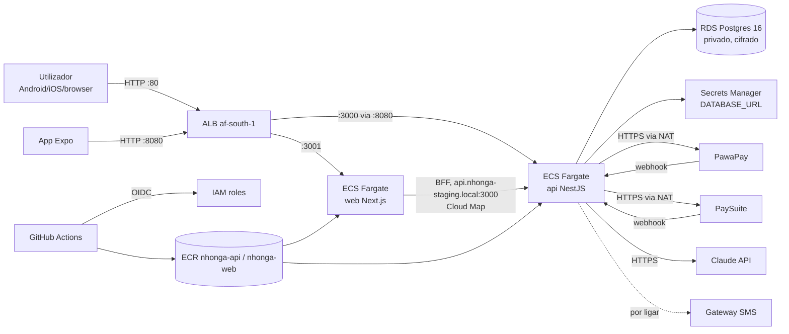

# 00 — Inventário (Fase 0)

Base auditada: commit `14e952c` (main, 22/11/2026) e o staging em
`http://nhonga-staging-62630277.af-south-1.elb.amazonaws.com`.
Evidências: `evidencias/inventario-tamanhos.txt`, `evidencias/config-diversa.txt`.

## Estrutura do repositório

Monorepo pnpm 9.12 + Turborepo.

| Pasta                    | O que é                                                                       | Tamanho                       |
| ------------------------ | ----------------------------------------------------------------------------- | ----------------------------- |
| `apps/api`               | API NestJS 12.6 (monólito modular), Drizzle ORM 0.45 + postgres.js            | 122 ficheiros, ~15 100 linhas |
| `apps/web`               | Loja web Next.js 15.5 (App Router), React 19.1; 53 rotas BFF em `app/api`     | 162 ficheiros, ~25 000 linhas |
| `apps/mobile`            | App Expo 57 / React Native 0.86, **npm, fora do workspace pnpm**              | 64 ficheiros, ~4 000 linhas   |
| `packages/shared`        | Tipos, telefone MZ, máquinas de estado de pagamento (com 145 testes)          | 11 ficheiros                  |
| `packages/design-tokens` | Tokens de cor e tipografia                                                    | 2 ficheiros                   |
| `infra/terraform`        | AWS: `bootstrap` (OIDC, estado), `envs/staging`, `envs/production`, 7 módulos | 18 ficheiros                  |
| `.github/workflows`      | `ci.yml`, `terraform.yml`, `deploy.yml`                                       | 3 ficheiros                   |

Não existe app de administração nem workers separados: as tarefas periódicas
(reconciliação, varrimento de pagamentos) correm dentro do processo da API.

## Stack

| Camada              | Tecnologia                                                                             |
| ------------------- | -------------------------------------------------------------------------------------- |
| Linguagem           | TypeScript 5.6 em todo o lado (mobile em TS 6.0)                                       |
| API                 | NestJS 12.6, helmet, rate limit próprio em memória                                     |
| Web                 | Next.js 15.5.29, React 19.1.10, `output: standalone` no contentor                      |
| BD                  | PostgreSQL 16 (RDS), Drizzle ORM, migrações Drizzle + SQL manuais (`apps/api/drizzle`) |
| Pesquisa            | Em memória na API (sem índice de texto na BD), ver `05-dados.md`                       |
| Ficheiros / imagens | **base64 dentro do Postgres** (`media_asset.data_base64`), servido por `/api/media`    |
| Cache / filas       | Nenhum (sem Redis, sem SQS)                                                            |
| CDN                 | Nenhuma (sem CloudFront)                                                               |
| Pagamentos          | Checkout alojado: PawaPay (principal), PaySuite (reserva), gateway mock + simulador    |
| SMS                 | Mock; gateway real por ligar (`SMS_GATEWAY_URL`)                                       |
| IA                  | Assistente, estúdio de banners e pesquisa IA (Claude API)                              |
| Mobile              | Expo Router, `expo-secure-store` para o token                                          |

## Arquitectura

## Fluxos críticos

| Fluxo                         | Onde                                                    | Estado                                                         |
| ----------------------------- | ------------------------------------------------------- | -------------------------------------------------------------- |
| Login por OTP                 | `auth.service.ts`, BFF `api/auth/*`                     | Funciona; corridas e limites corrigidos em SEC-01/02           |
| Publicar anúncio com fotos    | `catalog.service.createListing`, `media.service`        | Funciona; **aceita publicação sem sessão** (loja "Comunidade") |
| Pesquisa e filtros            | `catalog.service` (pontuação em memória)                | Funciona; não escala                                           |
| Contacto / chat               | `messaging.service`                                     | Verifica participante                                          |
| Pagamento (carteira, pacotes) | `checkout.service` + gateways                           | Testado com Postgres (TEST-02)                                 |
| Denúncias                     | `POST /catalog/products/:id/reports` → `listing_report` | Guarda; **não há painel de moderação**                         |
| Admin                         | `GET /ads/admin`, `GET /promotions/admin/active`        | **Públicos, sem autenticação**                                 |

## Build, testes e deploy

- CI (`ci.yml`): formatação, lint, typecheck, limites de dependências, build,
  testes, lint de OpenAPI, gitleaks + `pnpm audit`, Terraform fmt/validate +
  Trivy.
- `terraform.yml`: plan em PR, apply automático do staging no push para `main`
  quando mudam `envs/` ou `modules/`; produção por disparo manual com aprovação.
- `deploy.yml`: após CI verde no `main`, constrói as imagens (API e web) e
  actualiza o staging; produção por disparo manual.
- Acesso à AWS por OIDC, sem chaves no GitHub.

## O que não consegui auditar

| Lacuna                                                | Porque                                                      | O que preciso                                                        |
| ----------------------------------------------------- | ----------------------------------------------------------- | -------------------------------------------------------------------- |
| Consola AWS (CloudTrail, GuardDuty, IAM real, custos) | Sem credenciais na sessão                                   | Acesso de leitura (role `ReadOnlyAccess`) ou exportações             |
| App mobile compilada                                  | Não há build EAS nem dispositivo                            | Um APK/IPA de teste                                                  |
| Lighthouse em rede 3G real                            | Medi peso com Chrome headless, não Core Web Vitals em campo | Autorização para Lighthouse CI contra o staging                      |
| Testes de carga                                       | Proibidos sem autorização                                   | Autorização explícita (plano em `07-escalabilidade-elasticidade.md`) |
| Contratos PawaPay/PaySuite e SMS                      | Contas por abrir                                            | Credenciais sandbox                                                  |
| Validação jurídica                                    | Fora do âmbito técnico                                      | Advogado (CONT-03, CONT-04)                                          |
